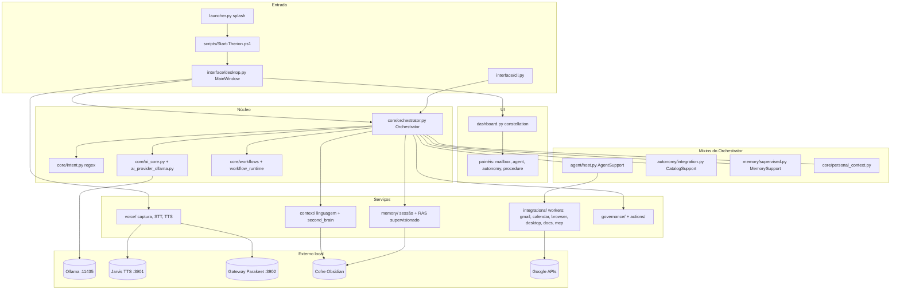
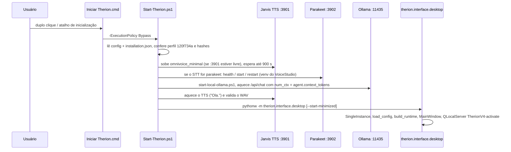

# Mapa do código do Therion

> Gerado pelo Cartographer. Último mapeamento: 2026-11-05T16:28:47Z.
> Os tokens são estimados (bytes/4). Os arquivos grandes foram lidos em parte (cabeçalho, definições e trechos-chave), então confirme no código antes de mudar algo importante.

## Visão geral

O Therion ("Thérion", no estilo Jarvis) é um assistente pessoal local em pt-BR para Windows. Ele tem uma interface desktop em PySide6 (orbe "constellation", bandeja do sistema e voz) e uma CLI. Responde por texto e por voz. Lê o Segundo Cérebro (cofre do Obsidian), consulta o Google Calendar e o Gmail, cuida das tarefas da sessão, abre e fecha apps aprovados e tem uma camada de agente opcional (browser, desktop, documentos, web, MCP).

O LLM é local, via Ollama (padrão `qwen3:4b-instruct`). O desenho é **determinístico primeiro e com governança pesada**: o modelo só classifica ou prepara, o código revalida tudo, e qualquer efeito real exige uma confirmação humana atrelada a um fingerprint.

**Stack:**
- Python 3.14 no `.venv` e PySide6 6.11.
- httpx/urllib para falar só com o loopback.
- Voz: faster-whisper ou Parakeet (sherpa-onnx) para reconhecimento, e Kokoro-onnx, edge-tts ou OmniVoice "Jarvis" para síntese.
- Google API client para Calendar e Gmail, Playwright para o browser, pywinauto para a automação de desktop.
- pypdf, python-docx, openpyxl e reportlab para documentos.
- SQLite para histórico e evidências.
- pytest e unittest nos testes.



## Estrutura de pastas

```
F:\Therion\                 (só a pasta app\ é código; o resto são modelos e laboratórios)
├── app\                    código + git (este mapa)
│   ├── Iniciar Therion.cmd → scripts\Start-Therion.ps1 (atalho principal)
│   ├── Testar *.cmd        launchers dos testes da pilha de voz
│   ├── AGENTS.md           governança "Camada Zero" para o OpenCode
│   ├── README.md           instalação, testes, notas da migração de 26/10/2026
│   ├── opencode.json, .opencode\agents\   permissões e agentes do OpenCode
│   ├── requirements*.txt   conjuntos opcionais; o lock real é requirements-migration.lock.txt
│   ├── therion\            pacote principal
│   │   ├── core\           orquestrador, intenções, IA, workflows, planos
│   │   ├── interface\      UI Qt (desktop, dashboard, painéis, orbe OpenGL, launcher, cli)
│   │   ├── agent\          loop de agente com tool-calling no LLM local
│   │   ├── integrations\   ferramentas: Gmail, Calendar, browser, desktop UIA, docs, MCP, tarefas
│   │   ├── voice\          microfone, VAD, STT, TTS em subprocesso, playback
│   │   ├── memory\         memória da sessão + notas RAS supervisionadas no cofre
│   │   ├── autonomy\       apps aprovados, rotinas, evidências, atalho de inicialização
│   │   ├── context\        gramática pt-BR, leitura do cofre, frame da conversa, revisão de notas
│   │   ├── calendar\       porta de calendário + Google + diálogo de data e hora
│   │   ├── skills\         ECC, cybersecurity, graphify, plan_day (SKILL-002)
│   │   ├── config\         config.json, aliases, contrato de acesso ao conhecimento
│   │   ├── governance\     confirmação s/n e allowlist de permissões
│   │   ├── actions\        executor e verificador reais (só Obsidian)
│   │   ├── logging\        auditoria JSONL redigida + log de conversa opcional
│   │   └── assets\         ícones, imagens e vídeos (não mapeado)
│   ├── scripts\            launchers .ps1 + ~47 scripts de QA, benchmark, diagnóstico e configuração
│   │   ├── voice_gateway\     gateway Parakeet :3902 (experimento de 20/10/2026, hoje em uso)
│   │   └── omnivoice_minimal\ servidor de TTS "Jarvis" :3901 (perfil 120f734a)
│   ├── tests\              ~225 arquivos, sem conftest.py
│   └── tmp\                capturas e vídeos de QA (centenas de MB, só em parte no .gitignore)
├── models\                 faster-whisper-small etc.
├── ollama-models\          OLLAMA_MODELS
├── agent-evolution-validation\  saídas das avaliações (passadas por --output)
└── tools\, tts-tests\, model-test\  laboratórios
```

## Guia dos módulos

### core/ — o hub (~84k tokens)

**Função:** transforma uma frase do usuário em um `OrchestrationResult`.
**Ponto de entrada:** `Orchestrator.process_session_command(command, session_id, confirmation_id, cancelled, presentation)`, chamado pela UI, e `process_command`, usado pela CLI e pelos testes.

| Arquivo | Função | Tokens |
|---|---|---|
| `orchestrator.py` | Máquina de estados da sessão, com 3.321 linhas e mixins | ~43.6k |
| `ai_provider_ollama.py` | `OllamaProvider`: `/api/chat`, só loopback, prompt classificador em JSON | ~15.9k |
| `workflows.py` | Interpreta pedidos compostos de 2 a 5 passos (não executa) | ~4.0k |
| `personal_context.py` | Mixin de "quem sou eu" e perfil, a partir de `01 - Pessoal/Perfil.md` | ~3.6k |
| `workflow_support.py` | Liga os workflows ao orquestrador | ~3.5k |
| `ai_core.py` | Valida a saída do modelo: `ACTION_ALLOWLIST` e schemas fechados | ~3.5k |
| `intent.py` | `IntentRecognizer`: regex determinística em pt-BR | ~3.4k |
| `workflow_runtime.py` | Executa os passos e guarda os recibos | ~1.9k |
| `plan_state.py` | Planos gerados, só em memória | ~1.7k |
| `ai_provider.py` | Contrato `AIProvider` + `plan_blocks` | ~1.4k |
| `inference_lock.py` | Mutex nomeado `Local\TherionInference-*` | ~0.7k |
| `windows_credentials.py` | Lê `Therion/Gemini` do Credential Manager | ~0.5k |
| `planner.py` | `Plan` simples (abrir app + verificar) | ~0.2k |

**Classes que o `Orchestrator` herda:** `WorkflowSupport`, `MemorySupport`, `PersonalContextSupport`, `CatalogSupport` e `AgentSupport`.
**Usado por:** `interface/desktop.py`, `interface/cli.py`, `autonomy/routines.py` e os scripts de QA.

### interface/ — UI Qt (~114k tokens)

**Função:** só a UI, sem regra de negócio. Hospeda um `Orchestrator`, os serviços de voz e a saída de TTS.
**Pontos de entrada:** `desktop.main()` (o app), `launcher.main()` (splash que roda `Start-Therion.ps1` e acompanha `:3901/startup/progress`) e `cli.main()`.

| Arquivo | Função | Tokens |
|---|---|---|
| `desktop.py` | `MainWindow` (UI clássica e dono da sessão), bandeja, voz, modo conversa | ~26k |
| `dashboard.py` | Skin "constellation": navegação, home, composer, orbe | ~23k |
| `mailbox_panel.py` | Caixa do Gmail (QtWebEngine opcional) | ~9.4k |
| `autonomy_panel.py` | Diálogo "Autonomia": apps, rotinas, memória técnica, evidências | ~8.8k |
| `agent_panel.py` | "Capacidades e histórico": liga e desliga `agent.*`, OAuth do Gmail | ~7k |
| `launcher.py` | Splash animado | ~6.4k |
| `constellation.py`, `singularity.py`, `scene_flow.py` | Orbe em OpenGL/GLSL, com fallback estático | ~10k |
| `surface_dialogs.py`, `workspace.py` | Diálogos dentro da cena e painéis flutuantes | ~7.4k |
| `design_system.py` | Paleta violeta "Obsidiana" + QSS | ~1.5k |
| `graphics.py`, `native_accessibility.py` | Ordem de OpenGL/WebEngine e pré-inicialização do UIA | ~1.3k |

**Fluxo dos comandos:** `_send_command` → `_CommandWorker(QThread)` → `Orchestrator.process_session_command` → `_finish_command`/`_apply_command_result`, que atualiza o orbe e o dashboard. Os workers nunca tocam nos widgets.

### agent/ — agente com ferramentas (~61k tokens)

**Função:** loop limitado de tool-calling no Ollama local. "O modelo só prepara, o humano confirma, o host verifica."
**Ponto de entrada:** `agent/host.py` → `AgentSupport._dispatch_agent(command, cancelled)`. Ele devolve `None` para cair no caminho legado. Fica **desligado por padrão** (`agent.enabled=False`).

| Arquivo | Função | Tokens |
|---|---|---|
| `host.py` | Dispatch, providers determinísticos (atalhos sem LLM) e registro das ferramentas | ~12.3k |
| `runtime.py` | `AgentRuntime.run`: loop, orçamento, cancelamento, single-flight | ~5.7k |
| `store.py` | `SessionStore` SQLite (opt-in) | ~3.4k |
| `ollama.py` | `OllamaAgentProvider` (protocolos json/native, ajustes para Qwen3) | ~3.1k |
| `context.py` | Prompt `SYSTEM` em pt-BR + empacotamento do contexto | ~3k |
| `proposals.py` | `ActionProposals`: preview, digest, TTL, `_EFFECT_GATE` | ~2.9k |
| `registry.py` | `ToolRegistry`, schemas estritos, `initial_tools` por regex | ~2.4k |
| `gmail_*.py`, `mailbox.py`, `briefing.py` | Atalhos de e-mail e o panorama do dia | ~12k |
| `claims.py`, `reading.py` | Bloqueiam "enviei/salvei" sem recibo e exigem leitura de verdade | — |

**Estado:** `%LOCALAPPDATA%\Therion\agent`, com ACL restrita ao usuário.

### integrations/ — back-ends das ferramentas (~36k tokens)

**Função:** Gmail, Google Calendar, browser (Playwright), desktop (pywinauto UIA), documentos, MCP, tarefas e rotinas.
**Padrão:** os SDKs de terceiros rodam em **subprocessos `OwnedWorker`** (`rpc.py` + `worker.py`), que trocam JSONL com o processo principal. Esses workers têm ambiente restrito a uma lista fixa e limite de memória por Job Object. O processo Qt nunca importa esses SDKs.

| Arquivo | Função |
|---|---|
| `tools.py` (~7.5k) | `register_personal_tools`: ferramentas `gmail_*`, inbox e tarefas |
| `gmail.py`, `google_transport.py` | Adapter do Gmail; transporte httpx sem proxy, sem redirect e com allowlist de hosts |
| `browser.py`, `visual_tools.py` | Playwright com `allowed_url` (https, só IPs públicos), busca no DuckDuckGo |
| `desktop.py` | Sessão UIA que verifica pid, exe e SHA256, e recusa shells e diálogos de credencial |
| `mcp.py`, `mcp_tools.py` | Até 4 servidores stdio com hash fixado, só ferramentas de leitura |
| `calendar.py` | Ferramentas de calendário do agente (escrita verificada) |
| `rpc.py`, `worker.py` | `OwnedWorker(kind)` para browser, desktop, documents, gmail, mcp e calendar |

### voice/ (~22k tokens) e os servidores de voz em scripts/

**Função:** captura → fim da fala → STT → núcleo → TTS → playback. **Não tem wake word:** a escuta começa por push-to-talk ou pelo modo conversa.

| Arquivo | Função |
|---|---|
| `capture.py`, `activity.py`, `endpointing.py` | Mic de 16 kHz pelo sounddevice, VAD Silero (do faster-whisper), fim da fala após 0,7 s de silêncio |
| `pipeline.py`, `cycle.py` | Máquina de estados com contador de geração; half-duplex (bloqueia o mic durante a fala +0,6 s) |
| `transcription.py`, `service.py` | faster-whisper (cpu, int8), hotwords tunados e rejeição da captura inteira se o áudio não estiver claro |
| `http_model.py` | Parakeet via `POST :3902/v1/audio/transcriptions` |
| `speech_output.py` (~4.9k) | `SpeechOutput`: worker em QProcess, chunks de WAV em ordem, pré-síntese do prefixo |
| `kokoro_worker.py`, `edge_worker.py`, `voicestudio_worker.py` | Workers de TTS (cada um no próprio Python) |
| `process_tree.py` | Wrapper de Job Object do Windows |

`scripts/omnivoice_minimal/server.py` serve o TTS Jarvis na **:3901** (CUDA obrigatório, perfil `120f734a`). `scripts/voice_gateway/server.py` serve o STT Parakeet e faz o relay do TTS na **:3902**.

### memory/ (~23k tokens)

**Função:** memória volátil da sessão + escrita **supervisionada** de rascunhos "RAS" no cofre.
- **Volátil:** `WorkingMemory` (500 turnos / 500k caracteres), `SessionTasks` (30 tarefas), `session_recall` (busca por palavra-chave, sem LLM).
- **Persistente (desligada por padrão):** "lembre que X" → candidato → "salve" → `SaveProposal` → confirmação no painel → `RAS-YYYYMMDD-NNN - Therion - Rascunho.md` em `<cofre>/90 - Sistema da IA/Notas de Rascunho da IA/Registros/`, com recibo em `evidence.sqlite3`.
- **`coordinator.py`:** `INFERENCE_GATE`. A conversa tem prioridade sobre a extração em segundo plano.
- **`runtime.py`:** `KnowledgeRuntime.install(orchestrator)` altera o orquestrador no próprio objeto.

### autonomy/ (~22k tokens)

**Função:** deixar o Therion agir sem pedir confirmação, uma operação estreita por vez. As operações são `open_app`, `close_app`, `remember_procedure`, `daily_summary` e `review_notes`.
- **Política:** dura no máximo 7 dias e permite até 10 execuções por dia. Exige o `implementation_version` (hash de todos os `.py` do núcleo) igual ao da concessão e nenhum incidente ou pausa ativa.
- **Catálogo de apps:** só `.exe`, identificado por caminho, SHA-256 e tamanho, e aberto com `Popen(shell=False)`. Para fechar, manda `WM_CLOSE` e nunca mata o processo.
- **Rotinas:** resumo diário e revisão semanal (fuso America/Sao_Paulo). Só rodam com a sessão do Windows desbloqueada.
- **Estado:** `%LOCALAPPDATA%\Therion\autonomy\state.sqlite3`.

### context/ (~16k tokens)

- **`language.py`:** `control()` normaliza o texto (minúsculas, sem acento, sem "therion," no começo) e é usado em todo o código. `prohibited_action` detecta negação junto com verbo de ação.
- **`second_brain.py`:** `SecondBrainReader` lê só `.md` dentro das raízes permitidas (padrão: `90 - Sistema da IA` e `10 - Projetos/Therion`). A busca é por força bruta com `os.walk`, sem índice.
- **`read_scope.py`:** `ReadScope` só estreita as raízes, nunca alarga (DEC-033).
- **`conversation_frame.py`:** tema atual e pergunta pendente, com TTL de 300 s, mais os parsers de hora, data e status de app.
- **`knowledge_review.py`, `semantic_review.py`:** revisão e fusão de 1 a 5 notas, só por proposta. As citações do modelo precisam ser substrings literais da fonte.

### calendar/, skills/, config/, governance/, actions/, logging/

- **calendar/:** ABC `CalendarAdapter` + `GoogleCalendarAdapter` (escopo `calendar.events.owned`, tokens em `%APPDATA%\Therion\`) + `dialogue.py`, o parser de data e hora em pt-BR ("terça-feira", "dia 12", "15h30").
- **skills/:** `registry.py` estático. `ecc` e `cybersecurity` leem playbooks com hash fixado em `~/.codex/skills/`. `graphify` roda `F:\Graphify\venv`. `plan_day` é a SKILL-002, a visão do dia só para leitura.
- **config/local.py:** `%APPDATA%\Therion\config.json`. Tudo é fail-closed: `runtime.real_actions_enabled=False`, IA e agente desligados. A escrita é atômica. `alias_manager.py` cuida dos aliases e `knowledge.py` do contrato `knowledge_access` (V3).
- **governance/:** `ConfirmationHandler` (s/sim/pode vs n/não/cancela) e `PermissionManager` (`ALLOWED_TARGETS={"Obsidian"}`).
- **actions/:** `ActionExecutor`/`ActionVerifier` reais, que só abrem o Obsidian (verificado com `tasklist`). Os outros apps passam pelo `CatalogSupport`.
- **logging/:** `AuditLogger` grava em `logs/audit.jsonl`, redigindo segredos e caminhos e sem guardar o conteúdo da conversa. `ConversationLog` é opt-in e grava em `%LOCALAPPDATA%\Therion\conversas`.

### scripts/ (~72k tokens no nível de cima)

- **Inicialização:** `Start-Therion.ps1` (a principal), `VoiceStartup.ps1` (funções), `start-local-ollama.ps1` e `Launch-Therion.ps1` (wrapper protegido).
- **Instalação:** `Install-LocalVoice.ps1` e `Restore-LocalVoice.ps1` (atalhos com backup).
- **Configuração** (prévia por padrão, `--apply` para gravar): `configure-voice`, `configure-knowledge-v3`, `configure-gmail`, `connect-calendar`, `configure-discord-close` e `make-therion-icon`.
- **QA isolado:** `evaluate-*`, `benchmark-*`, `diagnose-*`, `preview-*` e `pilot-hermes`. Usam fixtures fictícias, AppData temporária e um Ollama filho na **11436**.
- **Removidos em 05/11/2026 (Lixeira):** os scripts da era V3 `evaluate-memory-v3`, `evaluate-v3-remediation`, `evaluate-v3-two-fixes` e `v3-test-desktop`, que nada chamava.
- **Template repetido:** os `evaluate-*` de conversa seguem o mesmo padrão (Orchestrator + AICore + Ollama na 11435).

### tests/ (~394k tokens, ~225 arquivos)

- **Frameworks:** pytest na maioria, com unittest nos arquivos antigos (`test_orchestrator.py` com 85 testes, `test_second_brain.py` com 63 e os de alias e calendário).
- **Sem `conftest.py`:** os helpers são importados entre arquivos de teste. Exemplos: `ScriptedProvider` de `tests.test_agent_runtime`, `FakeInputStream` de `tests.test_voice_capture`, `FakeMailbox` de `tests/mailbox_fixture.py`. Por isso os testes precisam rodar a partir da raiz.
- **Isolamento:** `Orchestrator(simulate=True)`, mocks do LLM e do Google, `tmp_path`, `execute_real` com guarda `AssertionError`. Nenhum teste chama o Ollama, o Gmail ou o Calendar de verdade.
- **Precisam de ambiente real:** uns 40 arquivos Qt (sem `QT_QPA_PLATFORM=offscreen`), `test_agent_desktop` (UIA real), `test_agent_browser` (Edge visível), `test_native_accessibility` e `test_voice_startup_script` (PowerShell), e os testes de mutex do Windows.
- **Os maiores:** `test_desktop_integration.py` (151 testes), `test_ai_core.py` (76), `test_ai_provider_ollama.py` (73) e `test_voice_conversation.py` (41).
- **Como rodar:** `scripts/test-v4.py tests/...`, que isola a AppData com `THERION_TEST_ROOT`.

## Fluxos de dados

### Inicialização (atalho)



### Uma frase do usuário (caminho legado)

```mermaid
sequenceDiagram
    participant UI as MainWindow/_CommandWorker
    participant O as Orchestrator
    participant AG as AgentSupport
    participant IR as IntentRecognizer
    participant AI as AICore/OllamaProvider
    participant G as Permission/Catalog + Planner
    participant X as Executor/Verifier
    UI->>O: process_session_command(cmd, session_id, confirmation_id)
    O->>O: rejeita sessão ou confirmação velha; navegação de e-mail e panorama
    O->>AG: _dispatch_agent (se agent.enabled)
    AG-->>O: resultado ou None
    O->>O: atalhos determinísticos (memória, workflow, escopo "raízes: ::", hora/data, perfil, tarefas, fluxos multi-turno)
    O->>IR: parse (regex)
    alt sem intenção
        O->>AI: classify_detailed → valida → _ai_action_matches_request
    end
    O->>G: alias → is_allowed / catálogo → create_plan
    O-->>UI: awaiting_confirmation + confirmation_id novo
    UI->>O: confirm_session_proposal (s/n)
    O->>X: execute_real / verify_real (ou simulado)
    O->>O: auditoria redigida + registro do turno
    O-->>UI: OrchestrationResult (+ speech_message → SpeechOutput)
```

### Voz

`AudioCaptureService` (16 kHz + VAD) → `VoicePipeline` (geração) → `VoiceTranscriptionService` (Whisper) ou `HttpVoiceModel` (:3902) → `MainWindow._on_voice_transcribed` → orquestrador → `SpeechOutput` (worker Kokoro/Edge/VoiceStudio) → chunks de WAV → `QSoundEffect`. O `VoiceCycle` bloqueia o mic enquanto o Therion fala.

### Efeito do agente (ex.: rascunho no Gmail)

O modelo chama `*_prepare_*` → `ActionProposals.prepare` (preview, digest, TTL, evidência) → a UI mostra e o humano confirma → o executor revalida o digest e a conta, executa sob `_EFFECT_GATE`, verifica e grava o recibo → `claims.unsupported_claim` bloqueia qualquer "enviei" sem recibo.

## Convenções

- **Idioma:** UI, mensagens, prompts, comentários e regex estão em pt-BR. O usuário é tratado por "senhor".
- **Estilo compacto:** muitos arquivos (agente, interface, testes) usam várias instruções por linha separadas por `;` e poucos docstrings. Editar por linha é frágil, então prefira trocas exatas de trecho.
- **Negar por padrão:** feature flags desligadas, `authorize` nega por padrão, allowlists e saída do modelo, conteúdo de arquivo e fala tratados como **dados**, nunca como autorização.
- **Sem retry:** uma escrita, ação ou síntese incerta é reportada como `uncertain` e não é repetida.
- **Contadores de geração e epoch** descartam resultados atrasados (UI, voz, dashboard, agente).
- **Higiene de caminhos:** `safe_path`, `st_nlink==1`, nada de symlink ou junction, raízes declaradas por tarefa.
- **Estados terminais nomeados:** `success`, `failed`, `blocked`, `cancelled`, `uncertain`, `awaiting_confirmation` e `awaiting_clarification`.
- **Padrão `_pending_*` + `_reset_*`** para os fluxos multi-turno do orquestrador.

## Pegadinhas

- **Editar qualquer `.py` do núcleo invalida as concessões de autonomia:** `autonomy/integration.py:implementation_version` faz hash de 11 pacotes.
- **`Dashboard` acoplado à `MainWindow` por nomes privados:** renomear `_history`, `_input`, `_voice_button` etc. quebra o `attach_controls`.
- **Porta do Ollama:** o padrão no código é `127.0.0.1:11434`, mas a produção sobe o Ollama na **11435** e o QA na **11436**. Os scripts de QA exigem a 11436 livre.
- **`num_ctx` do aquecimento:** precisa bater com `agent.context_tokens`, senão o Ollama recarrega o modelo.
- **Caminhos fixos no código:** `F:\Therion\app`, `F:\Ollama\ollama.exe`, `F:\Therion\ollama-models`, `F:\VoiceStudio\runtime\project\.venv`, `F:\Graphify\venv` e o cofre em `C:\Users\marcu\Downloads\Segundo-Cerebro` (`second_brain.DEFAULT_VAULT_ROOT`). Sem o disco F: montado, nada sobe.
- **Perfil de voz:** `Start-Therion.ps1` aborta se a config fugir do perfil aprovado (`120f734a`, cuda, 16 steps, hashes).
- **Dois ou mais Pythons:** o app usa `app\.venv` (3.14), e os workers de TTS e o Parakeet usam os seus (`tts.python_path`, venv do VoiceStudio).
- **`DEFAULT_CONFIG.copy()` é cópia rasa:** quem chama pode mutar os dicts aninhados do padrão.
- **`therion/logging` tem o mesmo nome do `logging` da stdlib.** Importe sempre como `therion.logging`.
- **`memory.knowledge.MemoryError`** tem o mesmo nome do builtin.
- **O `PermissionManager` só conhece o Obsidian.** Os outros apps passam pelo catálogo de autonomia, e os aliases só valem para o Obsidian.
- **Notas RAS editadas à mão ficam inválidas** (`deserialize` exige o texto exato). A trava `.therion-memory.lock` guarda pid + hora de criação do dono. Desde 05/11/2026, uma trava cujo dono morreu é liberada sozinha, junto com as sobras `.therion-*.tmp`; travas antigas, de outro dono ou de processo vivo continuam bloqueando.
- **Hash da autonomia:** o hash do código é calculado uma vez por processo (`_code_digest`, com cache). Editar o código só invalida as permissões depois de reiniciar o app.
- **`requirements-agent.lock.txt` está em UTF-16** e talvez o pip não leia direto.
- **Testes Qt sem `offscreen`** precisam de uma sessão gráfica. Sem conftest, os helpers vêm de outros arquivos de teste.
- **`tmp/`:** centenas de MB de vídeos de QA. O `.gitignore` só cobre algumas subpastas, e a busca do second_brain pula `tmp` porque ele já estourou o limite de 30 s.
- **Git:** em 05/11/2026 havia ~250 arquivos não rastreados e as notas `.md` antigas da raiz apareciam como apagadas. O README pede para **não** dar stage nem commit nessas remoções.
- **`therion/__init__.py`:** `__version__ = "0.1.0"` está desatualizado.

## Guia de navegação

- **Novo comando de voz/texto determinístico:** parser em `context/conversation_frame.py` ou `context/language.py` → ramo em `core/orchestrator.py:_process_command` (respeitando a ordem dos atalhos) → testes em `tests/test_<tema>.py` + `test_frases_reais.py` (`tests/frases_reais.txt`).
- **Nova intenção por regex:** `core/intent.py` (a ordem importa) → `core/ai_core.py:ACTION_ALLOWLIST`, se o LLM também puder produzi-la → dispatch no orquestrador → `tests/test_intent.py`.
- **Nova ferramenta do agente:** `ToolSpec` em `integrations/tools.py` ou `visual_tools.py` (efeito `read`/`prepare`) → registro em `agent/host.py` (~linhas 485–499) → regex em `agent/registry.py:initial_tools` → flag em `agent/settings.py` → testes `tests/test_agent_*.py` com `ScriptedProvider`.
- **Nova integração externa:** worker em `integrations/<x>.py` + `kind` em `integrations/worker.py` → `OwnedWorker('<x>')` em `rpc.py` → host permitido em `google_transport.py`, se for API do Google.
- **Mexer na voz (STT):** `voice/transcription.py` (hotwords, limiares) ou `voice/http_model.py` + `scripts/voice_gateway/`. **TTS:** `voice/speech_output.py` + o worker do provider + `config/local.py` (regras do `tts`).
- **Mexer na UI:** `interface/desktop.py` (lógica e sessão) e `interface/dashboard.py` (skin). Estilo em `design_system.py`. Testes Qt em `test_constellation.py` e `test_desktop_integration.py`.
- **Novo app aprovado ou nova rotina:** `autonomy/apps.py` (catálogo), `autonomy/routines.py`, `interface/autonomy_panel.py`. Lembre que mudar código invalida as concessões.
- **Mexer na memória persistente:** `memory/supervised.py`, `memory/repository.py`, `memory/knowledge.py:MemoryPolicy`, contrato em `config/knowledge.py`.
- **Inicialização e portas:** `scripts/Start-Therion.ps1`, `scripts/VoiceStartup.ps1`, `scripts/start-local-ollama.ps1`.
- **Rodar os testes:** `.venv\Scripts\python.exe scripts\test-v4.py tests\<arquivo>.py` a partir de `F:\Therion\app`.
